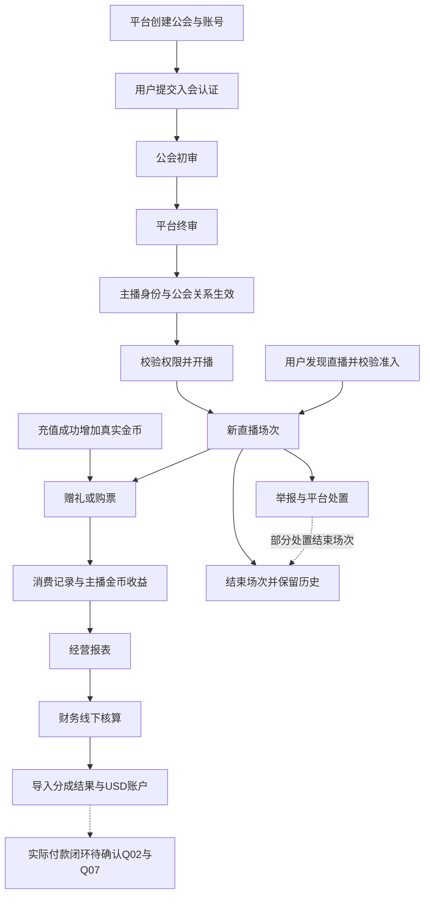

# Luma Live 业务流程阅读入口

> 当前来源梳理版，2026-10-12。未确认原型是否已审核冻结，未验证后端或线上行为。
> “来源一致”表示当前文件相互支持；“来源冲突”表示不同文件给出不同规则；“需求待确认”表示缺少完整定义。不得把这些标签替换成正式业务批准。

这份材料把当前项目按业务目标、对象状态和跨端接力整理。建议先理解下面三条骨架，再读各流程的异常和逆向路径。

- 主播供给：平台创建公会 → 用户提交入会认证 → 公会初审 → 平台终审 → 获得主播身份 → 检查开播权限 → 开播。
- 观看消费：发现直播 → 校验房间准入 → 观看互动 → 充值／赠礼／购票 → 形成消费、贡献与主播收益 → 场次结束并保留历史。
- 经营核算：业务明细与报表 → 财务线下核算 → 平台导入分成 → USD账户与快照。实际付款闭环存在来源冲突，暂留待确认。

图中的审核箭头是成功路径；驳回、停用、退会、退款和处罚等分支在详细文档中。上述骨架是阅读组织方式，不证明存在一条线上自动执行链路。

| 阅读层级 | 文件 | 用途 |
|---|---|---|
| 主线与旁枝 | [主要流程与分支](01-主要流程与分支.md) | 10项业务的角色、触发、结束、步骤、状态、异常和跨端关联 |
| 决策缺口 | [冲突与待确认](02-冲突与待确认.md) | 16项问题的正反依据、当前处理方式、待决定内容 |
| 下钻原文 | [来源细节索引](03-来源细节索引.md) | 全部252个三端批注条目，包括字段与交互；按文件名辅助归类 |
| 页面核对 | [独立页面清单](04-独立页面清单.md) | 当前190个HTML文件与批注关联 |
| 可复核快照 | [来源快照](来源快照.json) | 当前来源SHA-256、批注行号、原文内容和页面路径 |

## 必须分开的对象

| 对象 | 生命周期／口径 | 不能混同的内容 |
|---|---|---|
| 账号 | 登录、封禁、注销 | 主播身份和直播权限 |
| 入会申请 | 公会初审→平台终审→终态 | 有效公会关系；公会通过不等于入会 |
| 公会关系与主播身份 | 平台通过生效；退出后失去身份 | 公会管理账号启停 |
| 平台权限、公会权限、锁定状态 | 最终开播资格由多条件决定 | 页面显示的某一个开关 |
| 直播间与场次 | 直播间ID长期存在；每次开播创建新场次 | 门票、禁言、踢出等本场范围 |
| 用户金币 | 充值／奖励／消费／退款；可出现负余额 | 主播金币收益、USD分成账户 |
| 主播金币收益 | 普通礼物与幸运礼物计算基数不同 | 消费净额、榜单贡献、公会分成金额 |
| 分成账户与实际付款 | 线下核算结果导入形成USD余额 | 已导入不等于已付款 |
| 关注、好友、粉丝团 | 独立关系；解除后果各异 | 群禁言、直播间禁言、账号拉黑 |
| 运营虚拟金币 | 公会发放，只用于运营效果 | 真实金币、经营收入和分成 |

## 建议阅读顺序

1. 第一遍只读本页和F02、F03、F04、F05，能讲清身份、场次和资金三个闭环；付款缺口要明确讲出。
2. 第二遍补F06、F07，理解退出、处罚如何改变原主线。
3. 第三遍补F01、F08、F09、F10，再查配置／权限／消息如何挂到具体步骤。
4. 第四遍根据Q编号核对争议，不用旧清单默默覆盖当前批注，也不因批注更新就宣称正式审批已完成。
5. 每次只拿一个具体场景，追踪同一申请ID、场次ID或订单号跨端走完，再查来源细节。

## 来源与边界

已读取系统概要、项目说明、三端项目需求清单及原型规范，并提取全部三端批注、核对主流程相关条目；页面清单读取HTML标题，未逐页验证浏览器交互，未验证后端、数据库、SDK或支付渠道。业务流程归纳优先使用概要与当前跨端批注相互支持的规则；冲突保持显式待确认。

原型规范将审核通过的原型作为开发依据，但当前未找到能够证明全部页面已审核冻结的状态记录。因此本交付是理解和确认业务的材料，不是正式验收规则、测试执行结果或完整审计报告。

项目说明引用但当前缺失的文件：

- `context/01-业务对象清单.md`
- `context/01-用户主播App-角色与用例.md`
- `context/01-互动场景权限规则.md`
- `context/01-用户主播App-页面架构.md`
- `context/05-页面架构-01-一级页面定义.md`

这些缺失文件没有被当作已读取依据。早期聊天、历史排查和workspace旧任务未用于补充当前业务规则。页面数量和批注数量只说明清单范围，不说明语义覆盖已经通过。
